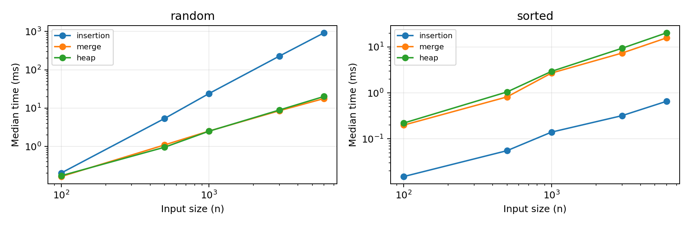

# 정렬 비교 보고서

삽입 정렬 · 병합 정렬 · 힙 정렬 | 과제 1 | 2026년 9월 29일

이름: 신규림    학번: 2022106103

GitHub 저장소: https://github.com/Fa1tumn/Compare_sorting

## 1. 비교 목적과 선정 이유

수업에서 배운 삽입 정렬과 병합 정렬, 제시된 수업 목록에 없는 힙 정렬을 비교한다. 삽입 정렬은 입력이 이미 정렬되어 있을 때 빠르지만 이동량이 많으면 느려진다. 병합 정렬은 추가 배열을 사용하여 입력 순서의 영향을 줄인다. 힙 정렬은 배열 안에서 최대 원소를 반복해서 꺼내므로 최악 시간과 추가 공간을 함께 살펴보기 좋다.

핵심 질문은 ‘항상 가장 빠른 정렬이 있는가?’이다. 입력 크기와 정렬 상태를 바꾸면서 실행 시간을 측정하고, 안정성과 추가 공간은 코드 구조 및 별도 정확성 검사로 비교한다. 내장 sorted()는 정답 검증에만 사용하며 비교 대상 알고리즘 구현에는 사용하지 않았다.

## 2. 구현 기준 이론 비교

| 알고리즘 | 최선 / 평균 / 최악 시간 | 추가 공간 | 안정성 |
| --- | --- | --- | --- |
| 삽입 | O(n) / O(n²) / O(n²) | O(1) | 안정 |
| 병합 | O(n log n) / O(n log n) / O(n log n) | O(n) | 안정 |
| 힙 | O(n)* / O(n log n) / O(n log n) | O(1) | 불안정 |

* 힙 정렬의 최선 O(n)은 모든 키가 같은 입력에서 본 구현의 sift_down이 즉시 종료하는 경우이다. 서로 다른 키에 대한 일반적인 힙 정렬 설명과 구별한다. 평균 시간은 무작위 입력에 대한 통상적 분석이며, O 표기는 점근적 상한이다. 병합 정렬에는 이미 정렬된 구간을 건너뛰는 최적화를 넣지 않았다.

안정 정렬은 같은 키를 가진 원소의 원래 순서를 유지한다. 추가 공간에는 입력 배열을 포함하지 않는다. 병합 정렬은 길이 n의 보조 배열과 O(log n) 재귀 스택을 사용하므로 전체 추가 공간은 O(n)이다.

---

# 3. AI 학습 첨부: 힙 정렬

아래는 이 과제를 준비하면서 AI가 작성한 학습 설명이다. 학생이 별도로 이해도를 확인했다는 진술이나 실제 사용자 질문 기록은 아니다. 코드·실험·초안 작성에도 AI 도움을 사용했으며, 제출자는 구현과 결과를 직접 검토해야 한다.

## 학습 주제 1 | 힙은 정렬된 배열인가?

최대 힙은 모든 부모의 값이 자식 값 이상인 완전 이진 트리이다. 루트가 가장 크다는 사실은 보장되지만, 형제끼리나 배열 전체가 정렬되어 있지는 않다. 0부터 시작하는 배열에서 인덱스 i의 왼쪽 자식은 2i+1, 오른쪽 자식은 2i+2이므로 별도 트리 노드가 없어도 구현할 수 있다.

## 학습 주제 2 | 어떻게 오름차순으로 정렬하는가?

① 마지막 부모 n//2-1부터 루트까지 sift_down을 수행하여 최대 힙을 만든다. ② 루트와 현재 힙의 마지막 원소를 교환한다. ③ 방금 놓은 최댓값을 힙에서 제외한다. ④ 루트에서 더 큰 자식 방향으로 내려가며 힙 조건을 회복한다. 남은 힙의 크기가 1이 될 때까지 반복한다.

| 단계 | 배열 상태 (\| 오른쪽은 확정된 영역) |
| --- | --- |
| 입력 | [4, 1, 3, 2] |
| 최대 힙 구성 | [4, 2, 3, 1] |
| 4를 뒤로 이동 후 복구 | [3, 2, 1 \| 4] |
| 3을 뒤로 이동 후 복구 | [2, 1 \| 3, 4] |
| 마지막 교환 | [1 \| 2, 3, 4] |

## 학습 주제 3 | 힙 구성은 왜 O(n)인가?

모든 노드가 트리 높이만큼 내려가지는 않는다. 절반 정도는 리프이고, 아래쪽 노드일수록 내려갈 거리가 짧다. 높이 h인 노드가 대략 n/2^(h+1)개이므로 전체 작업량은 n × Σ(h/2^(h+1))에 비례하고 O(n)이다. 이후 최대 n-1번의 추출은 각각 O(log n)이라 전체 최악 시간은 O(n log n)이 된다. 이 설명은 Princeton의 힙 구성·정렬 설명 [2]로 확인했다.

## 학습 주제 4 | 공간과 안정성의 대가는?

본 구현은 sift_down을 반복문으로 작성하여 추가 공간이 O(1)이다. 다만 떨어진 두 원소를 교환하므로 안정적이지 않다. 키만 비교할 때 [2A, 2B, 1C]는 [1C, 2B, 2A]가 되어 같은 키 2의 순서가 바뀐다. 이 반례는 테스트로도 확인했다. 동일 키의 입력 순서를 유지해야 하는 문제라면 이 구현의 힙 정렬은 적합하지 않다.

---

# 4. 실험 설계와 검증

## 동일 조건으로 측정하기

입력 크기는 100, 500, 1000, 3000, 6000이고, 각 크기·분포마다 7회 측정했다. 기본 난수 시드는 20260929이다. 반복마다 재현 가능한 다른 시드를 사용하되, 세 정렬에는 같은 원본의 복사본을 주었다. 정렬됨·역순은 반복 간 내용이 같고 나머지 분포는 난수가 달라진다.

| 입력 분포 | 생성 방법 |
| --- | --- |
| 무작위 | 0부터 n-1까지의 서로 다른 정수를 섞음 |
| 정렬됨 / 역순 | 0..n-1 오름차순 / n-1..0 내림차순 |
| 거의 정렬됨 | 오름차순 배열에서 max(1, n//100)번 임의 두 위치 교환 |
| 중복 많음 | 각 위치에 0..9 중 하나를 균등하게 생성 |

각 알고리즘을 n=100 무작위 입력으로 3회 예열한 뒤, 매 반복의 실행 순서를 섞었다. perf_counter_ns()로 정렬 함수 호출만 측정했다. 입력 생성·복사·정답 생성·검증·파일 쓰기는 측정에서 제외했고, 정렬 내부 보조 배열 할당은 포함했다. 측정 중 순환 가비지 수집은 중지한 뒤 원래 상태로 복원했다.

대표값은 중앙값이며, 표의 Q1-Q3는 7개 측정값의 inclusive 방식 사분위수이다. 이는 신뢰구간이 아니다. 난수 입력의 차이와 운영체제 실행 편차가 함께 포함된다. 입력 크기별 동일 조건의 총 525개 정렬 결과를 sorted()의 결과와 비교해 값과 중복 개수까지 검증했다.

## 실행 환경

Python: 3.11.2 (tags/v3.11.2:878ead1, Feb  7 2023, 16:38:35) [MSC v.1934 64 bit (AMD64)]
운영체제: Windows-10-10.0.26200-SP0
프로세서 식별: AMD64 Family 25 Model 117 Stepping 2, AuthenticAMD / 논리 프로세서 16개

측정 시각(UTC): 2026-09-29T12:13:24.241962+00:00. CPU 고정·부하 격리·주파수 고정은 수행하지 않았다. 따라서 수치는 이 환경에서 얻은 관측값이며 다른 컴퓨터에서 동일한 절대 시간이 재현된다고 보장하지 않는다.

## 정확성 및 안정성 테스트

unittest의 5개 테스트 메서드가 통과했다. 빈 배열·단일 값·음수·중복·정렬·역순을 확인했고, {-1, 0, 1}로 만들 수 있는 길이 0..6의 모든 1,093개 배열과 난수 배열 100개를 각 정렬로 검사했다. (키, 원래 위치) 객체로 삽입·병합의 안정성을 확인했으며, 힙의 불안정성은 앞쪽 반례로 재현했다. 유한한 테스트는 모든 입력에 대한 수학적 증명을 대신하지 않는다.

---

# 5. 실제 측정 결과

아래 값은 n=6,000에서의 실행 시간이다. 단위는 ms이며 각 칸은 중앙값 [Q1-Q3]이다. 전체 75개 조합의 요약은 results/summary.csv, 원시 525개 관측값은 results/raw.csv에 저장했다.

| 입력 | 삽입 | 병합 | 힙 |
| --- | --- | --- | --- |
| 무작위 | 917.067 [898.067-941.444] | 17.741 [17.475-19.685] | 20.100 [19.605-22.609] |
| 정렬됨 | 0.657 [0.647-0.703] | 15.786 [14.866-16.275] | 20.305 [20.217-20.829] |
| 역순 | 1844.976 [1799.737-1885.499] | 17.995 [16.836-18.286] | 19.092 [18.449-20.756] |
| 거의 정렬됨 | 33.374 [28.789-34.316] | 21.744 [21.359-22.344] | 25.149 [24.549-26.594] |
| 중복 많음 | 828.099 [799.762-847.751] | 17.910 [17.413-18.128] | 18.262 [18.016-18.574] |

## 입력 크기에 따른 변화

그림 1. 무작위 입력(왼쪽)과 정렬된 입력(오른쪽)의 중앙 실행 시간. 두 축은 모두 로그 척도다. 작은 입력에서는 타이머·함수 호출 비용과 시스템 잡음의 비중이 커지므로 작은 차이를 일반화하지 않는다.

## 관측값 읽기

무작위 n=6,000에서 삽입 정렬은 병합 정렬보다 약 51.7배의 시간이 걸렸다. 반면 정렬된 입력에서 병합 정렬의 시간은 삽입 정렬의 약 24.0배였다. 삽입 정렬은 이미 제자리에 있는 원소를 거의 이동하지 않으므로 입력 순서에 따라 결과가 크게 달라졌다.

무작위 입력 크기를 3,000에서 6,000로 늘렸을 때 관측된 시간 배율은 삽입 4.03배, 병합 2.07배, 힙 2.25배였다. 유한한 크기의 관측값은 복잡도와 일치하는 경향을 살펴보는 근거이며 복잡도 자체의 증명은 아니다.

---

# 6. 해석, 한계와 재현 방법

## 어떤 상황에 무엇을 선택할까?

삽입 정렬은 작은 입력이나 이미 정렬된 입력에서 유리하다. 거의 정렬된 경우에도 임의의 먼 두 위치를 교환하면 많은 역전 쌍이 생길 수 있으므로, ‘교환 횟수 1%’를 ‘전체 원소 중 정확히 1%만 잘못됨’으로 해석하면 안 된다. 역순에서는 각 원소가 앞부분을 통과해야 하므로 제곱 시간의 부담이 나타난다.

병합 정렬은 입력 분포가 달라져도 O(n log n) 수행을 유지하며 안정성이 필요할 때 적합하다. 그 대가로 길이 n의 보조 배열이 필요하다. 힙 정렬은 최악 O(n log n)과 O(1) 추가 공간이 장점이다. 같은 점근적 시간이라도 비교·교환 횟수, 인덱스 계산, Python 인터프리터 비용이 달라 실제 속도는 같지 않다. 본 실험만으로 특정 내부 비용이 속도 차이의 원인이라고 단정하지 않는다.

결론적으로 입력 특성·안정성 요구·메모리 제약을 함께 고려해야 한다. 이번 실험은 시간만 직접 측정했다. 공간 복잡도는 구현에서 분석한 결과이며 실제 최대 메모리를 측정한 값이 아니다. 비교 대상은 직접 작성한 세 Python 구현으로 한정되며, 다른 언어나 내장 정렬의 성능까지 설명하지 않는다.

## 재현 및 파일 구성

1. python -m unittest -v : 정답 및 안정성 검사
2. python benchmark.py : 원시 시간·요약·환경 기록 생성
3. python -m pip install -r requirements.txt : 보고서 의존성 설치
4. submission.json에 이름·학번·GitHub URL 입력
5. python build_report.py : Markdown과 PDF 재생성

sorting.py는 세 알고리즘, benchmark.py는 입력 생성과 측정, test_sorting.py는 검증을 담당한다. 보고서는 results 파일을 읽어 표·그래프·비율을 생성하므로 다시 측정하면 관측값이 함께 갱신된다. 기본 글꼴은 Windows 맑은 고딕이며, 다른 환경에서는 REPORT_FONT와 REPORT_FONT_BOLD로 한글 TTF 경로를 지정한다.

## 참고 자료와 AI 사용 공개

[1] Wikipedia, Sorting algorithm - Comparison of algorithms. 과제에서 지정한 분류와 추가 정렬 선택을 확인. https://en.wikipedia.org/wiki/Sorting_algorithm#Comparison_of_algorithms

[2] Robert Sedgewick · Kevin Wayne, Algorithms 4th Edition, §2.4 Priority Queues. 최대 힙, 선형 시간 힙 구성, 정렬 단계를 확인. https://algs4.cs.princeton.edu/24pq/

[3] 과제 샘플 저장소 및 보고서. 제출물 구성 참고. https://github.com/lec-algorithm/hw1-sample-2026 및 report/REPORT.md. 위 웹 자료 확인일: 2026-09-29.

AI 사용: 이 대화의 AI가 힙 정렬 학습 설명, 코드, 테스트 및 보고서 초안 작성을 지원했다. 실험 수치는 실제 프로그램 실행에서 얻었다. 제출 전 학생 본인의 설명·이해 확인과 저장소 정보 반영이 필요하다.
